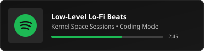

<div align="center">

  <!-- Bare-Metal Bootloader Animated Hero Banner -->
  <a href="https://github.com/azmainofficial/azmainofficial/tree/main/src">
    
  </a>

  <p align="center">
    <i>⚡ This hero banner is rendered from a real 2-stage x86 MBR bootloader (<code><a href="src/stage1_mbr.asm">src/stage1_mbr.asm</a></code> & <code><a href="src/stage2_payload.asm">src/stage2_payload.asm</a></code>) booted in QEMU via GitHub Actions.</i>
  </p>

  <p align="center">
    <a href="https://github.com/azmainofficial"></a>
    <a href="https://github.com/azmainofficial?tab=followers"></a>
    
    
  </p>

  <p align="center">
    <a href="mailto:azmiansheikh.nub@gmail.com"></a>
    <a href="https://linkedin.com/in/azmain-sheikh"></a>
  </p>

</div>

---

### 🖥️ `/proc/cpuinfo` & Kernel Diagnostics

```gdb
(gdb) target remote /dev/azmain
Remote debugging using /dev/azmain
(gdb) print *developer_info
$1 = {
    name       = "Azmain Sheikh",
    location   = "Dhaka, Bangladesh [UTC+6]",
    focus      = "Blending Systems Programming, Full-Stack & Machine Learning",
    current    = {"Python", "Laravel", "React Native", "TensorFlow"},
    ask_me     = {"C++", "Qt", "ML Pipelines", "System Design"},
    contact    = "azmiansheikh.nub@gmail.com",
    diagnostic = "I debug faster than I eat biryani 🍛"
}
```

---

### 🛠️ Hardware & Software Stack

<div align="center">
  
</div>

---

### 📊 System Telemetry & Glory

<div align="center">
  
  
  <br/><br/>
  
  
</div>

---

### 🎵 Audio Subsystem (Now Playing on Spotify)

<div align="center">
  
</div>

---

### 🐍 Memory Allocation Matrix (Contribution Snake)

<div align="center">
  
</div>

---

### 💬 Daily Dev Quote

<div align="center">
  
</div>

---

<div align="center">
  <sub>Built with ☕, x86 Assembly, and raw curiosity. Feel free to inspect <code><a href="src/stage1_mbr.asm">src/stage1_mbr.asm</a></code> to see how this profile was created!</sub>
</div>
